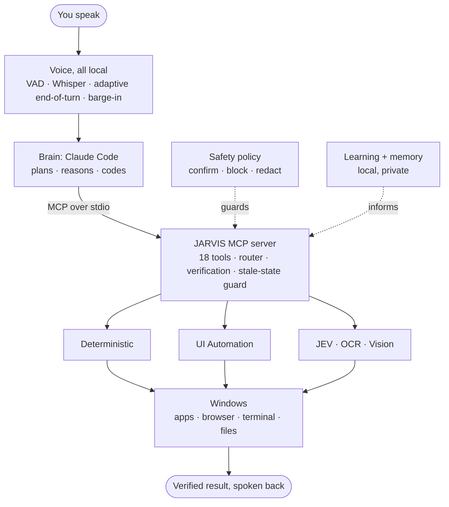

<div align="center">

# JARVIS · GNANI Edition

**A voice-controlled agent that operates your Windows PC.**<br>
Claude is the brain. Your desktop is the hands. Every action is verified.

[](#requirements)
[](requirements.txt)
[](https://claude.com/claude-code)
[](#the-18-tool-mcp-surface)
[](#privacy)
[](#install)

[Install](#install) · [How it works](#how-it-works) · [Using JARVIS](#using-jarvis) · [Performance](#performance) · [Safety](#safety) · [Troubleshooting](#troubleshooting) · [FAQ](#faq)

</div>

---

Hold a hotkey and say what you want:

> *"Open Chrome, find the latest Qwen paper, download it to my research folder, rename it properly, and summarize it."*

JARVIS transcribes you **on your machine**, lets Claude plan the task, and then carries it out on the real Windows
desktop. That means apps, windows, browser, files, terminal, keyboard and mouse. It checks that the download exists and
the rename happened, then tells you in a sentence. Anything destructive waits for your click.

**GNANI** (ज्ञानी, *"the knowing one"*) is the name of this edition.

## Highlights

| | |
|---|---|
| 🎙️ **Voice-first** | Local Whisper speech-to-text, adaptive end-of-turn detection, an instant "On it.", and you can interrupt mid-reply. |
| 🧠 **Claude as the brain** | Runs on your own Claude Code login through the official Agent SDK. Claude plans and reasons; it never micromanages clicks. |
| ⚡ **Cheapest path first** | Shortcuts and UI Automation before any model. A control is found in ~3 ms. Screenshots are the last resort, not the loop. |
| ✅ **Verified, not assumed** | Every tool reports whether the outcome actually happened. Stale screens are rejected and re-observed. |
| 🛡️ **Safe by construction** | Deletes, payments, credentials, registry and publishing need your confirmation. UAC, MFA and CAPTCHA are never bypassed. |
| 📈 **Learns your machine** | A local learning layer turns repeated decisions into instant local ones. Memory and a private knowledge graph stay on disk. |
| 🔮 **Lives on your desktop** | A floating, truly transparent orb that mirrors what JARVIS is doing. No terminal and no IDE needed. |

## Install

```powershell
git clone https://github.com/prabindersinghh/Jarvis-GNANI.git D:\JARVIS
D:\JARVIS\setup.cmd
```

That's it. Any folder works. You can also double-click `setup.cmd`, or open the folder in Claude Code and type
**`/setup`**.

<details open>
<summary><b>What setup does for you</b></summary>

<br>

Setup takes a fresh Windows 11 machine to a running JARVIS. Each step is skipped if it's already done, so re-running is safe.

| Step | Installed and configured automatically |
|:-:|---|
| 1 | **Python 3.12** via winget, if missing |
| 2 | **Claude Code CLI** via the official installer, if missing |
| 3 | **WebView2 runtime** for the orb, if missing |
| 4 | Virtual environment and every pinned Python dependency |
| 5 | **Whisper** speech model, downloaded locally |
| 6 | **MCP servers** for this folder: `jarvis` (18 tools) and `windows-mcp` (63 admin tools) |
| 7 | Claude Code workspace trust, so both servers load without prompts |
| 8 | Orb UI, data folders and the secrets template |
| 9 | Desktop shortcut **JARVIS** |
| 10 | Self-test (module imports and unit tests), then JARVIS launches |

</details>

**One manual step, once per machine:** sign in to Claude Code by running `claude` and logging in with your
Claude account. Setup tells you if this is still needed.

<details>
<summary><b>Setup options</b></summary>

```powershell
D:\JARVIS\setup.cmd -NoLaunch        # don't start JARVIS at the end
D:\JARVIS\setup.cmd -NoShortcut      # don't create the desktop shortcut
D:\JARVIS\setup.cmd -NoWindowsMcp    # skip the 63-tool Windows-MCP server (saves Claude context)
D:\JARVIS\setup.cmd -BuildExe        # also build dist\JARVIS.exe
```
</details>

### Requirements

| | |
|---|---|
| **OS** | Windows 11 (tested). Windows 10 2004+ is allowed by setup but untested. |
| **Account** | A Claude account that can use Claude Code (Pro or Max) |
| **Disk** | About 1 GB (dependencies and the Whisper model) |
| **Hardware** | Any modern CPU. No GPU needed; Whisper runs int8 on the CPU |
| **Optional** | A TypeSafe key for the JEV reflex layer (see [Configuration](#configuration)) |

## How it works

### The control ladder

Most computer-use agents screenshot, ask a model where to click, click, and repeat. That is slow and costly.
JARVIS sends every action down a ladder and stops at the first rung that works:

```
1  DETERMINISTIC     known shortcut · app launch · shell · file op         no model at all
2  UI AUTOMATION     structured Windows elements by id or name             ~3 ms to find a control
3  JEV REFLEX        fast structured pick among ambiguous targets          ~0.4 s, only when needed
4  OCR               text and bounds when an app exposes no structure
5  CLAUDE VISION     pixels, only when genuinely required
6  HUMAN             UAC · login · MFA · CAPTCHA are handed back, never bypassed
```

### Architecture



| Layer | Role | Code |
|---|---|---|
| **Brain** | Claude Code through the Agent SDK, the only general-purpose reasoner | `jarvis/app` |
| **Hands** | DPI-aware capture, SendInput, UI Automation, OCR, multi-monitor | `jarvis/computer` |
| **Router** | Tier selection, verification, waits, batched runs, the local act loop | `jarvis/orchestrator` |
| **Reflexes** | JEV (TypeSafe) structured decisions behind a hard monthly cap | `jarvis/jev` |
| **Ears & voice** | Microphone, VAD, Whisper, endpointing, barge-in, text-to-speech | `jarvis/voice` |
| **Safety** | Safe / confirm / blocked policy, confirmation dialog, secret redaction | `jarvis/safety` |
| **Learning** | Contextual-bandit policy over router decisions, with promote and rollback | `jarvis/learning` |
| **Memory** | Experience memory, daily conversations, private knowledge graph | `jarvis/memory` `jarvis/graph` |
| **Tasks** | Durable tasks, follow-ups, receipts, watches, notifications | `jarvis/tasks` |
| **Orb** | WebView2 composition host with true per-pixel transparency | `jarvis/ui` |

### The 18-tool MCP surface

| Group | Tools |
|---|---|
| Observe | `computer_observe` · `computer_screen` · `computer_status` · `computer_wait` |
| Act | `computer_click` · `computer_type` · `computer_key` · `computer_scroll` · `computer_drag` · `computer_element` |
| System | `computer_app` · `computer_window` · `computer_shell` · `computer_file` |
| Orchestrate | `computer_run` runs batched steps with `expect` checkpoints · `computer_act` runs a visible UI goal locally |
| Govern | `computer_confirm` · `computer_memory` |

Every tool returns a `verification` block. `verified: false` counts as failure, and a `stale_state` error forces a
fresh look at the screen before anything is retried. Sending input is never taken as proof that it worked.

The same server works in any Claude Code session opened in this folder, not just the voice app.

## Using JARVIS

1. Double-click **JARVIS** on the desktop. The orb appears bottom-right, with a tray icon.
2. Hold **Ctrl + Alt + J**, speak, and release. Or click the orb and type.
3. JARVIS acts, verifies, and replies out loud.

| Control | Action |
|---|---|
| `Ctrl + Alt + J` (hold) | Push-to-talk |
| `Ctrl + Alt + J` (tap) | Toggle hands-free listening; stops on silence |
| `Ctrl + Alt + X` | Emergency stop: interrupts Claude and any recording |
| Click the orb | Open the glass panel: type, see live activity and status |
| Right-click the orb | Listen · Mute · Settings · Log window · Hide · Exit |
| Speak while it talks | Barge-in: JARVIS stops and listens |

**Reply styles:** `silent` (text only), `concise` (one or two spoken sentences, the default) or `conversational`.
Switch them from the tray menu.

**Memory:** say *"remember that I keep papers in D:\Research"* and it will. Memory lives in `data\memory\` as
plain files you can read or delete.

## Configuration

All settings are in `data\config\settings.json`. Secrets go in `data\config\.env`, which is never committed.

| Setting | Default | Purpose |
|---|---|---|
| `hotkey` | `<ctrl>+<alt>+j` | Push-to-talk key |
| `whisper_model` | `base.en` | `tiny.en` is fastest; `small` is more accurate |
| `mic_device` | system default | Input device index |
| `response_mode` | `concise` | `silent` · `concise` · `conversational` |
| `claude_model` | your default | Pin a specific Claude model |
| `privacy.screenshots` | `allow` | `allow` · `confirm` · `never` |
| `privacy.blocked_titles` | password managers, private windows | Windows JARVIS will never look at |

**JEV reflex layer (optional):** add `TYPESAFE_API_KEY=…` to `data\config\.env`. JEV only decides between genuinely
ambiguous UI targets, and spend is hard-capped at ₹1,000 per month (it stops at ₹900 and fails closed). Without a key,
JARVIS uses a local tie-breaker and then Claude vision.

## Performance

Medians on a Windows 11 laptop (Intel Core Ultra 7, no GPU). Full tables in [`benchmarks/`](benchmarks/results.md).

| Operation | Median |
|---|---:|
| Find a UI Automation control | **3 ms** |
| Read control text | **4 ms** |
| Window screenshot | **33 ms** |
| Native click | **53 ms** |
| Full UI observation | **101 ms** |
| Type 20 characters, verified by read-back | **212 ms** |
| Launch an app, verified | **605 ms** |
| Launch → observe → type → verify, end to end | **2.18 s** |

Design wins that hold regardless of machine load ([details](benchmarks/latency/comparison.md)):

- **Batching** cut a three-task benchmark from **33 → 14** Claude turns and **27 → 7** tool calls.
- **Adaptive end-of-turn** finalizes short commands in **570 ms** instead of 930 ms, without cutting off hesitant speakers.
- **Instant acknowledgement** arrives in about **90 ms**; Claude's first token takes 2.9 to 11 s.
- **Learning** brought JEV calls per task from **3 → 0** while keeping a 3/3 success rate.

## Safety

- **Confirmation required** for deletion, destructive git, registry, firewall and security changes, credentials,
  payments, and anything that publishes or sends. The dialog is raised by the engine, not the model, and a "no" is final.
- **Never bypassed:** UAC secure desktop, the lock screen, MFA, CAPTCHA and biometrics. JARVIS hands control back to you.
- **Outside the learner:** safety rules and the spending cap sit outside the learning layer, so learning can never relax them.
- **Secrets stay out:** typed secrets are redacted from logs, `.env` is never read into Claude's context, and
  `.gitignore` keeps keys and personal data out of git.

### Privacy

Your **audio never leaves the machine**. Speech is transcribed locally. Conversations, memory and the knowledge graph are
stored only under `data\`. Claude sees the text of your request and the tool results it needs. Screenshots go to Claude
only when lower tiers fail, and you can set them to `confirm` or `never`.

## Troubleshooting

| Symptom | Fix |
|---|---|
| Setup stopped with `XX` | Read the line above it, fix the cause, and run `setup.cmd` again. Steps already done are skipped. |
| "Claude is not logged in" | Run `claude` once in any terminal and sign in. |
| Tools don't appear in Claude Code | Run `claude mcp list` in the JARVIS folder. Both `jarvis` and `windows-mcp` should show **Connected**. If not, re-run setup. |
| `JARVIS.exe` is blocked | Windows Smart App Control blocks unsigned builds. The default shortcut uses the signed `pythonw.exe`, so use that. |
| JARVIS doesn't hear you | Set `mic_device` in `settings.json`. List devices with `.venv\Scripts\python -c "from jarvis.voice.mic import list_input_devices as l; print(l())"` |
| Something else | Check `logs\jarvis.log` (app) and `logs\computer.log` (engine). |

## FAQ

**Does it cost extra?** No separate model bill: JARVIS runs on your existing Claude Code login. JEV is optional and capped.

**Does it work offline?** Speech recognition and the computer engine are local. Planning needs Claude, so it needs internet.

**Can it run on macOS or Linux?** No. The engine is built on Windows UI Automation and Win32 input.

**Will it click things without asking?** Routine actions, yes. That's the point. Anything destructive or irreversible
waits for your confirmation, and that check sits outside both Claude and the learning layer.

**Can I use the tools without the voice app?** Yes. Open the folder in Claude Code and the `jarvis` tools are already connected.

## Development

```powershell
.venv\Scripts\python -m pytest tests -q              # unit + fast integration
.venv\Scripts\python -m pytest tests -q -m live       # live GUI tests (moves the mouse)
.venv\Scripts\python -m benchmarks.run                # latency benchmark
.venv\Scripts\python -m jarvis.computer               # MCP server on stdio
.venv\Scripts\pythonw -m jarvis.app                   # run the product
.venv\Scripts\python -m jarvis.graph recall <term>    # query the memory graph
```

<details>
<summary><b>Repository map</b></summary>

```
setup.cmd · setup.ps1   one-command installer
jarvis/
  app/                  tray, Claude session, console
  computer/             MCP server + Windows engine (capture, input, UIA, OCR, DPI)
  orchestrator/         router, verification, waits, act loop, batching, metrics
  jev/                  TypeSafe adapter + monthly budget
  voice/                mic, Whisper, endpointing, barge-in, acknowledgement, TTS
  safety/               policy, confirmation, privacy redaction
  learning/             bandit policy, rewards, experience
  memory/ · graph/      experience memory, private knowledge graph
  tasks/                durable tasks, watches, receipts, events
  ui/                   the orb
launcher/               launcher + desktop shortcut
benchmarks/             latency, task and learning benchmarks
tests/                  unit, integration and live tests
docs/                   design, history, acceptance, usage
```
</details>

### Documentation

| Doc | Inside |
|---|---|
| [`docs/USAGE.md`](docs/USAGE.md) | Day-to-day use, in depth |
| [`docs/PROJECT_HISTORY.md`](docs/PROJECT_HISTORY.md) | How JARVIS was built, phase by phase |
| [`docs/FOUNDATION_DECISION.md`](docs/FOUNDATION_DECISION.md) | Why this engine over eight alternatives |
| [`PRD.md`](PRD.md) · [`TRD.md`](TRD.md) | Product and technical requirements |
| [`docs/RL_LEARNING.md`](docs/RL_LEARNING.md) | The learning layer |
| [`docs/GRAPH.md`](docs/GRAPH.md) | Memory graph and codebase graph |
| [`docs/ORB_UI.md`](docs/ORB_UI.md) | The orb interface |
| [`docs/ACCEPTANCE.md`](docs/ACCEPTANCE.md) | Acceptance record |
| [`CLAUDE.md`](CLAUDE.md) | Operating rules for the brain |

## Contributing

Issues and pull requests are welcome. Before opening a PR, run the unit tests
(`.venv\Scripts\python -m pytest tests -q`) and keep the core rules intact: cheapest tier first, verify every action,
and never route around the safety policy.

## Acknowledgements

JARVIS stands on excellent open-source work, credited in full in [`THIRD_PARTY_NOTICES.md`](THIRD_PARTY_NOTICES.md):
the Windows engine from [sshh12/windows-computer-use-mcp](https://github.com/sshh12/windows-computer-use-mcp) (MIT),
[Windows-MCP](https://github.com/danielsimonjr/Windows-MCP) (MIT), the thinking-orbs visual engine,
[faster-whisper](https://github.com/SYSTRAN/faster-whisper), [pywebview](https://github.com/r0x0r/pywebview),
graphifyy, and Anthropic's [Claude Agent SDK](https://github.com/anthropics/claude-agent-sdk-python).

---

<div align="center">

Built by **[Prabinder Singh](https://github.com/prabindersinghh)**

If JARVIS is useful to you, a ⭐ helps others find it.

</div>
