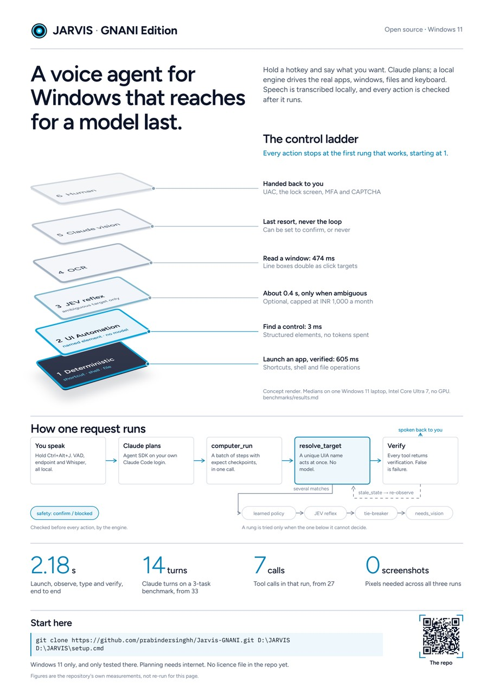
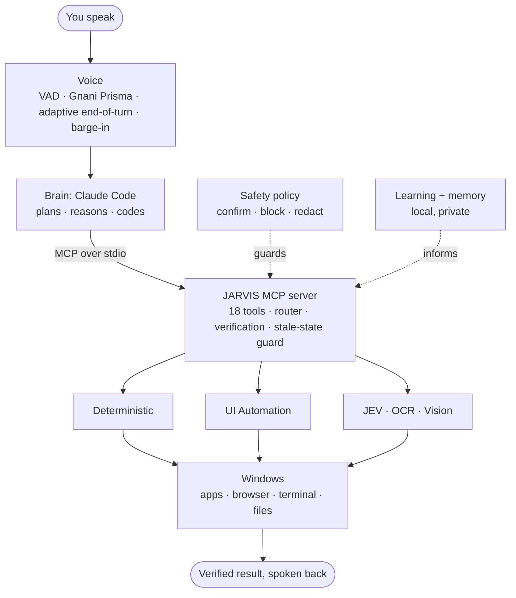
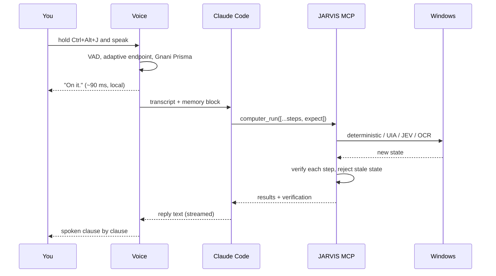

<div align="center">

# JARVIS · Gnani.ai

**A voice-controlled agent that operates your Windows PC.**<br>
Claude is the brain. Your desktop is the hands. Every action is verified.

[](#requirements)
[](requirements.txt)
[](https://claude.com/claude-code)
[](#the-18-tool-mcp-surface)
[](#privacy)
[](#install)

[Install](#install) · [How it works](#how-it-works) · [Tech stack](#tech-stack) · [Under the hood](#under-the-hood) · [Using JARVIS](#using-jarvis) · [Performance](#performance) · [Safety](#safety) · [Troubleshooting](#troubleshooting) · [FAQ](#faq)

<br>

<a href="docs/Jarvis-GNANI-one-pager.pdf"></a>

<sub><b>The one-pager</b> · <a href="docs/Jarvis-GNANI-one-pager.pdf">Download PDF</a></sub>

</div>

---

Hold a hotkey and say what you want:

> *"Open Chrome, find the latest Qwen paper, download it to my research folder, rename it properly, and summarize it."*

JARVIS transcribes speech with Gnani Prisma, lets Claude plan the task, and then carries it out on the real Windows
desktop. That means apps, windows, browser, files, terminal, keyboard and mouse. It checks that the download exists and
the rename happened, then tells you in a sentence. Anything destructive waits for your click.

**GNANI** (ज्ञानी, *"the knowing one"*) is the name of this edition.

## Highlights

| | |
|---|---|
| **Voice-first** | Gnani Prisma speech-to-text, adaptive end-of-turn detection, Timbre speech output, and interruptible replies. |
| **Claude as the brain** | Runs on your own Claude Code login through the official Agent SDK. Claude plans and reasons; it never micromanages clicks. |
| **Cheapest path first** | Shortcuts and UI Automation before any model. A control is found in ~3 ms. Screenshots are the last resort, not the loop. |
| **Verified, not assumed** | Every tool reports whether the outcome actually happened. Stale screens are rejected and re-observed. |
| **Safe by construction** | Deletes, payments, credentials, registry and publishing need your confirmation. UAC, MFA and CAPTCHA are never bypassed. |
| **Learns your machine** | A local learning layer turns repeated decisions into instant local ones. Memory and a private knowledge graph stay on disk. |
| **Lives on your desktop** | A floating, truly transparent orb that mirrors what JARVIS is doing. No terminal and no IDE needed. |

## Install

```powershell
git clone https://github.com/prabindersinghh/Jarvis-GNANI.git D:\JARVIS
D:\JARVIS\setup.cmd
```

That's it. Any folder works. You can also double-click `setup.cmd`, or open the folder in Claude Code and type
**`/setup`**.

<details open>
<summary><b>What setup does for you</b></summary>

<br>

Setup takes a fresh Windows 11 machine to a running JARVIS. Each step is skipped if it's already done, so re-running is safe.

| Step | Installed and configured automatically |
|:-:|---|
| 1 | **Python 3.12** via winget, if missing |
| 2 | **Claude Code CLI** via the official installer, if missing |
| 3 | **WebView2 runtime** for the orb, if missing |
| 4 | Virtual environment and every pinned Python dependency |
| 5 | Gnani API key in `data/config/.env` for Prisma and Timbre |
| 6 | **MCP servers** for this folder: `jarvis` (18 tools) and `windows-mcp` (63 admin tools) |
| 7 | Claude Code workspace trust, so both servers load without prompts |
| 8 | Orb UI, data folders and the secrets template |
| 9 | Desktop shortcut **JARVIS** |
| 10 | Self-test (module imports and unit tests), then JARVIS launches |

</details>

**One manual step, once per machine:** sign in to Claude Code by running `claude` and logging in with your
Claude account. Setup tells you if this is still needed.

<details>
<summary><b>Setup options</b></summary>

```powershell
D:\JARVIS\setup.cmd -NoLaunch        # don't start JARVIS at the end
D:\JARVIS\setup.cmd -NoShortcut      # don't create the desktop shortcut
D:\JARVIS\setup.cmd -NoWindowsMcp    # skip the 63-tool Windows-MCP server (saves Claude context)
D:\JARVIS\setup.cmd -BuildExe        # also build dist\JARVIS.exe
```
</details>

### Requirements

| | |
|---|---|
| **OS** | Windows 11 (tested). Windows 10 2004+ is allowed by setup but untested. |
| **Account** | A Claude account that can use Claude Code (Pro or Max) |
| **Disk** | Application dependencies; no local speech model download |
| **Hardware** | Microphone and audio output; internet access for Gnani speech APIs |
| **Optional** | A TypeSafe key for the JEV reflex layer (see [Configuration](#configuration)) |

## How it works

### The control ladder

Most computer-use agents screenshot, ask a model where to click, click, and repeat. That is slow and costly.
JARVIS sends every action down a ladder and stops at the first rung that works:

```
1  DETERMINISTIC     known shortcut · app launch · shell · file op         no model at all
2  UI AUTOMATION     structured Windows elements by id or name             ~3 ms to find a control
3  JEV REFLEX        fast structured pick among ambiguous targets          ~0.4 s, only when needed
4  OCR               text and bounds when an app exposes no structure
5  CLAUDE VISION     pixels, only when genuinely required
6  HUMAN             UAC · login · MFA · CAPTCHA are handed back, never bypassed
```

### Architecture



| Layer | Role | Code |
|---|---|---|
| **Brain** | Claude Code through the Agent SDK, the only general-purpose reasoner | `jarvis/app` |
| **Hands** | DPI-aware capture, SendInput, UI Automation, OCR, multi-monitor | `jarvis/computer` |
| **Router** | Tier selection, verification, waits, batched runs, the local act loop | `jarvis/orchestrator` |
| **Reflexes** | JEV (TypeSafe) structured decisions behind a hard monthly cap | `jarvis/jev` |
| **Ears & voice** | Microphone, VAD, Prisma, endpointing, barge-in, Timbre text-to-speech | `jarvis/voice` |
| **Safety** | Safe / confirm / blocked policy, confirmation dialog, secret redaction | `jarvis/safety` |
| **Learning** | Contextual-bandit policy over router decisions, with promote and rollback | `jarvis/learning` |
| **Memory** | Experience memory, daily conversations, private knowledge graph | `jarvis/memory` `jarvis/graph` |
| **Tasks** | Durable tasks, follow-ups, receipts, watches, notifications | `jarvis/tasks` |
| **Orb** | WebView2 composition host with true per-pixel transparency | `jarvis/ui` |

### The 18-tool MCP surface

| Group | Tools |
|---|---|
| Observe | `computer_observe` · `computer_screen` · `computer_status` · `computer_wait` |
| Act | `computer_click` · `computer_type` · `computer_key` · `computer_scroll` · `computer_drag` · `computer_element` |
| System | `computer_app` · `computer_window` · `computer_shell` · `computer_file` |
| Orchestrate | `computer_run` runs batched steps with `expect` checkpoints · `computer_act` runs a visible UI goal locally |
| Govern | `computer_confirm` · `computer_memory` |

Every tool returns a `verification` block. `verified: false` counts as failure, and a `stale_state` error forces a
fresh look at the screen before anything is retried. Sending input is never taken as proof that it worked.

The same server works in any Claude Code session opened in this folder, not just the voice app.

## Tech stack

| Layer | Technology | Version | Why |
|---|---|---|---|
| **Reasoning** | Claude Code CLI + [`claude-agent-sdk`](https://github.com/anthropics/claude-agent-sdk-python) | 0.2.157 | Uses your own Claude Code login, streams partial messages, and hosts MCP servers in-process config |
| **Tool protocol** | [Model Context Protocol](https://modelcontextprotocol.io) Python SDK (`mcp`), stdio transport | 2.2.0 | A standard, compact tool surface any Claude Code session can attach to |
| **Speech-to-text** | Gnani Prisma v3 REST API | Prisma v3.0 · `api.vachana.ai` | Indic multilingual recognition with automatic language detection |
| **Voice activity** | Silero VAD on ONNX Runtime + RMS energy gate | 1.30.0 | Cheap speech/silence decisions feeding the adaptive endpointer |
| **Audio I/O** | `sounddevice` (PortAudio), resampled to 16 kHz mono | 0.5.6 | Device-rate capture with any microphone |
| **Text-to-speech** | Gnani Timbre REST API with queued local playback | Timbre v2.5 · `api.vachana.ai` | Requires network and Gnani API key; replies are synthesized clause by clause |
| **UI Automation** | `uiautomation` (Microsoft UIA COM) | 2.0.29 | Structured element tree: roles, names, automation ids, patterns |
| **Input** | Win32 `SendInput` via `ctypes` (scan codes + Unicode) | n/a | Works in apps and games that ignore virtual-key events |
| **Capture** | `mss` (GDI BitBlt) + `PrintWindow(PW_RENDERFULLCONTENT)` | 10.2.0 | Fast desktop capture, and correct pixels even for GPU-composited windows |
| **OCR** | Built-in `Windows.Media.Ocr` through WinRT | OS | On-device OCR with zero extra installs |
| **Reflex decisions** | TypeSafe **JEV** `/v1/systemone` over `httpx` (HTTP/2) | 0.28.1 | About 0.4 s structured choice among UI candidates, priced per input token |
| **Orb UI** | WebView2 **composition controller** + DirectComposition, hosted through `pythonnet` | 3.1.0 | True per-pixel alpha on the desktop using only signed Windows components |
| **Orb visuals** | thinking-orbs engine (vendored), inlined into one HTML page | vendored | A state-driven animated orb with no build server |
| **Tray & hotkeys** | `pystray`, `pynput` | 0.19.5 · 1.8.2 | System tray menu and global push-to-talk |
| **Process & system** | `psutil`, `pywin32`, `ctypes` (user32, shcore, d3d11, dcomp) | 7.2.2 | Window, process and DPI control without native builds |
| **Imaging** | `pillow`, `numpy` | 12.3.0 · 2.5.3 | Downscaling, encoding and RMS math |
| **Storage** | SQLite (daily conversations), JSONL (experience), atomic JSON (policies, graph, budget) | stdlib | Local, inspectable, crash-safe |
| **Codebase graph** | `graphifyy` (tree-sitter) | 0.9.65 | A queryable architecture graph of this repo, fully local |
| **Admin tools** | [Windows-MCP](https://github.com/danielsimonjr/Windows-MCP) (.NET 9, prebuilt) | 2a74b3e | Optional registry, services, firewall, event log and WMI tools |
| **Packaging** | `pyinstaller`, PowerShell installer, signed `pythonw.exe` shortcut | 6.22.3 | One-command setup that works under Smart App Control |
| **Tests** | `pytest` with unit, integration and `-m live` desktop suites | 8.4.2 | Live tests drive real Notepad and Calculator windows |

Runtime: **Python 3.12** on **Windows 11**. No GPU, Docker, .NET SDK or Node.js is required at runtime.

## Under the hood

A deeper look at how each subsystem works. File references point at the implementation.

### Request lifecycle



### Windows engine · `jarvis/computer/engine`

- **DPI first.** Before any capture or input, the process sets **per-monitor-v2** DPI awareness (falling back to
  per-monitor, then system). Capture, `GetWindowRect` and `SendInput` then all agree on physical pixels, so clicks land
  correctly at 125% and 150% scaling and across mixed-DPI monitors.
- **Two capture paths.** `mss` (GDI BitBlt) grabs any physical rectangle of the virtual desktop.
  `PrintWindow(PW_RENDERFULLCONTENT)` captures one window's own pixels, even when it's covered or GPU-composited,
  where a screen BitBlt would come back black.
- **Input via `SendInput`** with hardware scan codes (`KEYEVENTF_SCANCODE`) and Unicode text (`KEYEVENTF_UNICODE`).
  Text is pasted first and read back from the field. On a mismatch, or in a field that rejects paste, it falls back to
  paced `SendInput`, one character per event, because WinUI apps (for example, the Windows 11 Notepad) corrupt batched
  Unicode input.
- **OCR** uses the OS's own `Windows.Media.Ocr` through WinRT: frames go to a `SoftwareBitmap` and then to an `OcrEngine`
  for the user's language. The line bounding boxes double as click targets.
- The engine is vendored from [sshh12/windows-computer-use-mcp](https://github.com/sshh12/windows-computer-use-mcp)
  (MIT), chosen over seven alternatives in [`docs/FOUNDATION_DECISION.md`](docs/FOUNDATION_DECISION.md).

### Stale-state protection · `jarvis/state/store.py`

Every observation gets an identity: a monotonically increasing `capture_id`, a timestamp, the target window (hwnd,
title, process) and a **SHA-1 fingerprint** over the compact element list (`role|name|bounds`). An action referencing
`capture_id N` runs only if N is still the latest observation **and** the live fingerprint of that window still matches.
Otherwise `StaleStateError` is raised and the caller re-observes, regenerates candidates and decides again. Coordinates
are never fired at a screen that has changed. Observations younger than 400 ms skip the second UIA walk, which saves
about 130 ms per click.

### Router · `jarvis/orchestrator/router.py`

`resolve_target()` turns a target spec into exactly one element or point and records which tier resolved it. Accepted
specs: `{"id": 7}` (an element from the last observation), `{"x":…, "y":…}` (needs a `capture_id`), `{"name": "Save",
"role": "button"}`, `{"automation_id": …}`, or `{"text": …}` (OCR allowed). A unique UIA match executes directly.
Several matches go to the learned policy, then JEV, then a local tie-breaker, then `needs_vision`. `execute()` wraps
every action with the stale-state check, the safety policy and a post-action verification
([`verify.py`](jarvis/orchestrator/verify.py)).

`computer_run` executes a whole batch of steps with `expect` checkpoints in a single tool call. It stops at the first
failure and returns the trace plus a fresh observation. `computer_act` hands a visible multi-step UI goal to a local
observe, decide, execute, verify loop so Claude isn't consulted for every click.

### JEV reflex layer · `jarvis/jev`

JEV is used only for **ambiguous** choices. One `POST /v1/systemone` request carries an *operation* head and a
speculative *target* head, and only the target head that matches the chosen operation is used. This design is adapted
from [browser-use/jev-ultrafast](https://github.com/browser-use/jev-ultrafast). Output tokens are free, so the extra head
saves a round trip at almost no cost. The adapter handles timeouts, bounded retry with backoff on 429/503/529,
cancellation through a `threading.Event`, response validation and a pre-warmed HTTP/2 connection. A local, persisted
**budget guard** stops spending at 90% of the ₹1,000 monthly ceiling and fails closed. With no key, the adapter raises
`JevUnavailable` and routing falls through to the next tier.

### Learning layer · `jarvis/learning`

A **contextual bandit** sits on the router's decision hook. The *context* is a privacy-safe hash of the app, a coarse
set of candidate signatures, goal keywords and a candidate-count bucket. The text is redacted before hashing, and no
pixels or raw content are used. The *arms* are candidate signatures (`role|name`). An arm is served only after
**≥ 3 trials** and a **Wilson lower confidence bound ≥ 0.72** on verified success (z = 1.28). Otherwise the policy
defers to the normal tiers.

Rewards lie in [−2, 2]. Verified correctness dominates, tier cost is secondary (JEV 0.06, OCR 0.04, vision 0.12), and a
blocked or denied action is a hard negative, so the policy learns where the boundary is, never a way around it. A
**candidate** policy learns online, while a **production** policy serves decisions. The candidate is promoted only on
measured improvement and rolled back on regression, with atomic, versioned persistence.

### Voice pipeline · `jarvis/voice`

- **Capture** at the device rate, resampled to **16 kHz mono**. An RMS gate and Silero VAD decide what is speech.
- **Adaptive endpointing** (`endpoint.py`) is a small state machine (`IDLE → SPEAKING → POSSIBLE_END → FINALIZED`).
  The trailing silence it needs depends on what was just said: **0.55 s** for a short, fluent command, **0.8 s** by
  default, and up to **1.3 s** once you've hesitated. Quick commands finalize fast, and nobody gets cut off mid-thought.
- **Transcription** with Gnani Prisma v3.0 over REST (`GNANI_API_KEY` in `data/config/.env`).
- **Instant acknowledgement** (`ack.py`). For task-like requests, a local "On it." plays in about 90 ms, long before
  Claude's first token.
- **Streaming speech.** Claude's reply is cut into complete clauses as it streams and each clause is synthesized by Gnani Timbre.
- **Barge-in** (`bargein.py`). Microphone frames are analysed even while JARVIS talks. Sustained speech above a raised
  threshold (0.035 RMS for at least 220 ms) interrupts the reply, so a cough, a click or JARVIS's own echo doesn't.

### Orb · `jarvis/ui/comphost.py`

A WinForms-hosted WebView2 renders into an opaque surface, so real transparency is impossible that way. JARVIS instead
drives WebView2's **composition controller** into a **DirectComposition** visual on a `WS_EX_NOREDIRECTIONBITMAP`
window, so DWM composites the orb onto the desktop with true per-pixel alpha. The rest of the desktop stays clickable
through hit-test regions. The host pumps its own STA message loop, forwards mouse and focus input, and sets
`RasterizationScale` to the monitor's DPI. Everything it touches (user32, d3d11, dcomp and
`Microsoft.Web.WebView2.Core.dll`) is a signed component, which matters under Smart App Control. The orb's state is
driven entirely by real runtime events.

### Memory, history and graph

| Store | Format | Contents |
|---|---|---|
| `data/memory/*.jsonl`, `preferences.json` | JSONL / JSON | Preferences, working workflows, corrections, app quirks, failures to avoid |
| `data/memory/conversations/history.db` | SQLite | One conversation per day. Shown in the panel, never sent wholesale to Claude |
| `data/graph/memory_graph.json` | Typed graph, atomic write + fsync | day → session → turn → app → tool → outcome → topic, redacted and bounded |
| `data/policies/` | Versioned JSON | Production and candidate learning policies |

The relevant slice of memory is injected as a `<memory>` block before each request. The memory graph exports to
graphify's `graph.json` format, so one set of tools can visualise both JARVIS's experience and its codebase.

### Events and tasks · `jarvis/tasks`

An in-process, thread-safe pub/sub bus carries every runtime event: run and task lifecycle, tool calls, streamed
messages, voice, TTS, JEV and verification. Event names follow **AG-UI** where an equivalent exists (`RUN_STARTED`,
`TOOL_CALL_START`, `STATE_DELTA`, …), so the stream can later be served to a phone or web client unchanged. A bounded
ring buffer gives late subscribers a snapshot. On top of the bus sits a durable task engine with an explicit state
machine (created → queued → planning → running → verifying → completed, plus waiting, needs-input, paused, failed
and cancelled), receipts, follow-ups, watches and
notifications.

### Safety policy · `jarvis/safety`

Every action is classified as **safe**, **confirm** or **blocked** before it runs. Confirmation dialogs come from the
engine, so the model can't skip them. Privacy controls redact secrets and personal data from everything sent to Claude
(`redact_cloud`), mask password, PIN, OTP and card fields, and refuse to observe or capture windows whose titles match
`blocked_titles` (by default 1Password, Bitwarden, KeePass, LastPass, Credential Manager, InPrivate and private browsing).

### MCP transport note

The server is launched over **stdio** by Claude Code (or by the Agent SDK inside the app). Because it takes several
seconds to import, it pins the classic `initialize` handshake rather than relying on `mcp`'s first-frame protocol
detection. A slow start can therefore never lock a connection to a protocol the client has already moved on from. See
`_pin_handshake_protocol()` in [`server.py`](jarvis/computer/server.py).

## Using JARVIS

1. Double-click **JARVIS** on the desktop. The orb appears bottom-right, with a tray icon.
2. Hold **Ctrl + Alt + J**, speak, and release. Or click the orb and type.
3. JARVIS acts, verifies, and replies out loud.

| Control | Action |
|---|---|
| `Ctrl + Alt + J` (hold) | Push-to-talk |
| `Ctrl + Alt + J` (tap) | Toggle hands-free listening; stops on silence |
| `Ctrl + Alt + X` | Emergency stop: interrupts Claude and any recording |
| Click the orb | Open the glass panel: type, see live activity and status |
| Right-click the orb | Listen · Mute · Settings · Log window · Hide · Exit |
| Speak while it talks | Barge-in: JARVIS stops and listens |

**Reply styles:** `silent` (text only), `concise` (one or two spoken sentences, the default) or `conversational`.
Switch them from the tray menu.

**Memory:** say *"remember that I keep papers in D:\Research"* and it will. Memory lives in `data\memory\` as
plain files you can read or delete.

## Configuration

All settings are in `data\config\settings.json`. Secrets go in `data\config\.env`, which is never committed.

| Setting | Default | Purpose |
|---|---|---|
| `hotkey` | `<ctrl>+<alt>+j` | Push-to-talk key |
| `prisma_model` | `prisma-v3.0` | Gnani Prisma speech recognition model |
| `prisma_language` | `indic-auto` | Automatic language detection for Prisma v3 |
| `timbre_model` | `timbre-v2.5` | Gnani Timbre speech synthesis model |
| `timbre_voice` | `Kaveri` | Voice name from the selected Timbre model |
| `timbre_language` | `en-IN` | Synthesis language |
| `mic_device` | system default | Input device index |
| `response_mode` | `concise` | `silent` · `concise` · `conversational` |
| `claude_model` | your default | Pin a specific Claude model |
| `privacy.screenshots` | `allow` | `allow` · `confirm` · `never` |
| `privacy.blocked_titles` | password managers, private windows | Windows JARVIS will never look at |

**JEV reflex layer (optional):** add `TYPESAFE_API_KEY=…` to `data\config\.env`. JEV only decides between genuinely
ambiguous UI targets, and spend is hard-capped at ₹1,000 per month (it stops at ₹900 and fails closed). Without a key,
JARVIS uses a local tie-breaker and then Claude vision.

## Performance

Medians on a Windows 11 laptop (Intel Core Ultra 7, no GPU). Full tables in [`benchmarks/`](benchmarks/results.md).

| Operation | Median |
|---|---:|
| Find a UI Automation control | **3 ms** |
| Read control text | **4 ms** |
| Window screenshot | **33 ms** |
| Native click | **53 ms** |
| Full UI observation | **101 ms** |
| Type 20 characters, verified by read-back | **212 ms** |
| Launch an app, verified | **605 ms** |
| Launch → observe → type → verify, end to end | **2.18 s** |

Design wins that hold regardless of machine load ([details](benchmarks/latency/comparison.md)):

- **Batching** cut a three-task benchmark from **33 → 14** Claude turns and **27 → 7** tool calls.
- **Adaptive end-of-turn** finalizes short commands in **570 ms** instead of 930 ms, without cutting off hesitant speakers.
- **Instant acknowledgement** arrives in about **90 ms**; Claude's first token takes 2.9 to 11 s.
- **Learning** brought JEV calls per task from **3 → 0** while keeping a 3/3 success rate.

## Safety

- **Confirmation required** for deletion, destructive git, registry, firewall and security changes, credentials,
  payments, and anything that publishes or sends. The dialog is raised by the engine, not the model, and a "no" is final.
- **Never bypassed:** UAC secure desktop, the lock screen, MFA, CAPTCHA and biometrics. JARVIS hands control back to you.
- **Outside the learner:** safety rules and the spending cap sit outside the learning layer, so learning can never relax them.
- **Secrets stay out:** typed secrets are redacted from logs, `.env` is never read into Claude's context, and
  `.gitignore` keeps keys and personal data out of git.

### Privacy

Microphone audio is sent to Gnani Prisma for transcription, and assistant reply text is sent to Gnani Timbre for synthesis. Conversations, memory and the knowledge graph are
stored only under `data\`. Claude sees the text of your request and the tool results it needs. Screenshots go to Claude
only when lower tiers fail, and you can set them to `confirm` or `never`.

## Troubleshooting

| Symptom | Fix |
|---|---|
| Setup stopped with `XX` | Read the line above it, fix the cause, and run `setup.cmd` again. Steps already done are skipped. |
| "Claude is not logged in" | Run `claude` once in any terminal and sign in. |
| Tools don't appear in Claude Code | Run `claude mcp list` in the JARVIS folder. Both `jarvis` and `windows-mcp` should show **Connected**. If not, re-run setup. |
| `JARVIS.exe` is blocked | Windows Smart App Control blocks unsigned builds. The default shortcut uses the signed `pythonw.exe`, so use that. |
| JARVIS doesn't hear you | Set `mic_device` in `settings.json`. List devices with `.venv\Scripts\python -c "from jarvis.voice.mic import list_input_devices as l; print(l())"` |
| Something else | Check `logs\jarvis.log` (app) and `logs\computer.log` (engine). |

## FAQ

**Does it cost extra?** No separate model bill: JARVIS runs on your existing Claude Code login. JEV is optional and capped.

**Does it work offline?** Computer control runs locally, but voice uses Gnani APIs and planning uses Claude, so those features need internet.

**Can it run on macOS or Linux?** No. The engine is built on Windows UI Automation and Win32 input.

**Will it click things without asking?** Routine actions, yes. That's the point. Anything destructive or irreversible
waits for your confirmation, and that check sits outside both Claude and the learning layer.

**Can I use the tools without the voice app?** Yes. Open the folder in Claude Code and the `jarvis` tools are already connected.

## Development

```powershell
.venv\Scripts\python -m pytest tests -q              # unit + fast integration
.venv\Scripts\python -m pytest tests -q -m live       # live GUI tests (moves the mouse)
.venv\Scripts\python -m benchmarks.run                # latency benchmark
.venv\Scripts\python -m jarvis.computer               # MCP server on stdio
.venv\Scripts\pythonw -m jarvis.app                   # run the product
.venv\Scripts\python -m jarvis.graph recall <term>    # query the memory graph
```

<details>
<summary><b>Repository map</b></summary>

```
setup.cmd · setup.ps1   one-command installer
jarvis/
  app/                  tray, Claude session, console
  computer/             MCP server + Windows engine (capture, input, UIA, OCR, DPI)
  orchestrator/         router, verification, waits, act loop, batching, metrics
  jev/                  TypeSafe adapter + monthly budget
  voice/                mic, Prisma, endpointing, barge-in, acknowledgement, Timbre TTS
  safety/               policy, confirmation, privacy redaction
  learning/             bandit policy, rewards, experience
  memory/ · graph/      experience memory, private knowledge graph
  tasks/                durable tasks, watches, receipts, events
  ui/                   the orb
launcher/               launcher + desktop shortcut
benchmarks/             latency, task and learning benchmarks
tests/                  unit, integration and live tests
docs/                   design, history, acceptance, usage
```
</details>

### Documentation

| Doc | Inside |
|---|---|
| [`docs/USAGE.md`](docs/USAGE.md) | Day-to-day use, in depth |
| [`docs/PROJECT_HISTORY.md`](docs/PROJECT_HISTORY.md) | How JARVIS was built, phase by phase |
| [`docs/FOUNDATION_DECISION.md`](docs/FOUNDATION_DECISION.md) | Why this engine over seven alternatives |
| [`PRD.md`](PRD.md) · [`TRD.md`](TRD.md) | Product and technical requirements |
| [`docs/RL_LEARNING.md`](docs/RL_LEARNING.md) | The learning layer |
| [`docs/GRAPH.md`](docs/GRAPH.md) | Memory graph and codebase graph |
| [`docs/ORB_UI.md`](docs/ORB_UI.md) | The orb interface |
| [`docs/ACCEPTANCE.md`](docs/ACCEPTANCE.md) | Acceptance record |
| [`CLAUDE.md`](CLAUDE.md) | Operating rules for the brain |

## Contributing

Issues and pull requests are welcome. Before opening a PR, run the unit tests
(`.venv\Scripts\python -m pytest tests -q`) and keep the core rules intact: cheapest tier first, verify every action,
and never route around the safety policy.

## Acknowledgements

JARVIS stands on excellent open-source work, credited in full in [`THIRD_PARTY_NOTICES.md`](THIRD_PARTY_NOTICES.md):
the Windows engine from [sshh12/windows-computer-use-mcp](https://github.com/sshh12/windows-computer-use-mcp) (MIT),
[Windows-MCP](https://github.com/danielsimonjr/Windows-MCP) (MIT), the thinking-orbs visual engine,
[Gnani speech APIs](https://docs.gnani.ai/api/introduction/introduction), [pywebview](https://github.com/r0x0r/pywebview),
graphifyy, and Anthropic's [Claude Agent SDK](https://github.com/anthropics/claude-agent-sdk-python).

---
